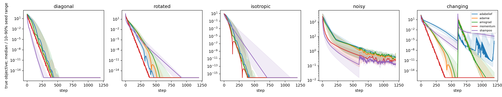

# Sprint 2 baseline validation

**Finding:** the earlier AdamW deficit on stationary quadratics does not survive
independent rate tuning and a longer budget. A stochastic late-loss gap remains,
but it is not evidence of AdamW nonconvergence or a need for low-rank geometry.

## Protocol and provenance

Inspected the existing synthetic objective, optimizer factory, reference Shampoo,
prospective moments, runner, pilot configurations, 99 saved metadata records,
reliability evaluator, foundation report and novelty assessment before editing.
The historical baseline used lr=0.001 for all methods and 100 steps; the original
reliability pilot had 150 steps and three evaluation seeds without run-level CIs.
Those files and raw results remain unchanged.

Branch: `research/sprint2-evidence-validation`, parent commit `5b75629`.
Protocol: [sprint2_protocol.md](sprint2_protocol.md), configuration:
[`sprint2.yaml`](../configs/synthetic/sprint2.yaml). Campaign:
[`campaign-20261012`](../results/sprint2/campaign-20261012).
Each attempt has its full configuration, configuration SHA256, status, environment,
source hash and buffered step CSV, including partial rows on failure. The immutable
initial source ZIP preserves the code loaded for the baseline stage; later stages
capture separate ZIPs. No old raw result is overwritten.

Five methods × five regimes × six learning rates × two development seeds = 300
tuning trials. Freeze per-method/per-regime rates using development seeds 10,11;
evaluate on matched seeds 20–24, giving 125 trials. Of 425 attempts, 421 completed
successfully and four tuning attempts failed: changing-curvature Momentum at
rates .01 and .03 on both development seeds exceeded the 1e100 divergence bound.
Their partial CSVs and errors are retained; selection disqualified these rates.
No trial was budget-censored. Every planned trial used 1,200 steps, CPU float64, one thread, zero decay,
4x4 parameter shape, identical seed-specific initialization, curvature bases and
noise draws. Baseline campaign execution took **245.81 seconds**, including setup
and I/O, against the sprint's 900-second cap. Initialization/intermediate timing
is not a neural-training benchmark.

Momentum=.9; adaptive betas=(.9,.999). AMSGrad uses official PyTorch Adam with its
maximum second moment. AdaBelief uses the existing unrectified residual algorithm.
Reference Shampoo is the existing original cumulative matrix-factor variant with
epsilon=1e-6, factors refreshed every step, no momentum or grafting; it is not a
modern production Shampoo comparison. Rates have equal trial counts but method
specific ranges. Other hyperparameters were held fixed.

## Held-out sustained performance

Primary outcome: mean true objective over steps 960–1199, then mean over five
evaluation runs. SDs and individual runs are in the
[summary CSV](../results/sprint2/campaign-20261012/processed/evaluation_summary.csv).
Changing curvature switches the rotated matrix from condition 100 to 1000 at step
600 while retaining optimum zero. Noise switches from standard deviation .1 to
10 at step 600, with anisotropic covariance condition 10. Other anisotropic cases
have condition 100; isotropic condition=1.

| Regime | AdamW | Momentum SGD | AMSGrad | AdaBelief | Reference Shampoo |
| --- | ---: | ---: | ---: | ---: | ---: |
| Diagonal | 7.24e-39 | 4.39e-44 | 3.62e-38 | 3.47e-39 | 4.15e-41 |
| Rotated | 1.81e-34 | 6.33e-44 | 4.46e-25 | 1.44e-39 | 2.02e-18 |
| Isotropic | 1.41e-39 | 9.42e-45 | 7.60e-39 | 4.33e-40 | 3.71e-16 |
| Noisy | 0.424 ± 0.139 | 0.271 ± 0.128 | 0.504 ± 0.194 | 0.458 ± 0.253 | 0.178 ± 0.037 |
| Changing curvature | 1.58e-12 | 7.81e-43 | 7.59e-12 | 5.66e-4 | 4.04e-4 |

Sub-1e-12 comparisons use a numerical floor in log-ratio analyses and have little
practical meaning. These toy values do not constitute neural benchmark results.
Every stationary evaluation run crossed 1% of its initial objective at least once;
this includes pre-noise-change crossings and does not prove sustained stochastic
accuracy. A stationary target is inapplicable to changing objectives; those runs
retain `target_censored=true` alongside `target_applicable=false` in metadata.

Selected rates (AdamW / Momentum / AMSGrad / AdaBelief / Shampoo):

| Regime | Rates |
| --- | --- |
| Diagonal | .03 / .003 / .03 / .01 / 1 |
| Rotated | .1 / .003 / .1 / .1 / 3 |
| Isotropic | .03 / .003 / .03 / .01 / .3 |
| Noisy | .01 / .0001 / .01 / .003 / .3 |
| Changing | .1 / .003 / .1 / .03 / 1 |

The rotated Shampoo optimum is at the upper grid boundary and noisy Momentum at
the lower boundary. Those comparisons need range extension in a later sprint;
we do not label this exhaustive hyperparameter tuning. AdamW selections are
interior. No betas/epsilon/decay search was conducted.

## Statistical and mechanistic interpretation

Whole paired-seed percentile bootstrap (1,000 draws), conditional on frozen
development selection: noisy log10 late-loss ratios to AdamW were Momentum
**-0.219 [-0.386,-0.106]**, Shampoo **-0.368 [-0.468,-0.249]**, AdaBelief
**-0.026 [-0.258,0.153]**, AMSGrad **+0.067 [0.013,0.104]**. Negative favors the
comparator. These are exploratory intervals from only five seeds, with no
multiple-comparison-adjusted significance claim and no resampling of the tuning
selection. See [paired results](../results/sprint2/campaign-20261012/processed/evaluation_paired_comparisons.json).

On the noisy case, harmful-update fractions were AdamW .223, Momentum .229,
Shampoo .255: lower late loss can coexist with more harmful steps. The label
measures local ascent, not generalization or global optimizer failure. Fixed
learning rates, additive noise and proximity to optimum explain a noise floor;
clipping, resets and rate schedules must be checked before interpreting it as a
missing geometric mechanism. Curvature alone did not establish a residual AdamW
failure here: AdamW recovered, while the ungrafted cumulative Shampoo reference
and AdaBelief retained larger tail errors.

Bands show descriptive 10–90% seed ranges, not confidence intervals. Plot values
below 1e-16 are clipped only for display. [Paired CI plot](../results/sprint2/campaign-20261012/figures/evaluation_paired.png).

## Published Adam construction, separately reproduced

[Reddi, Kale and Kumar](https://arxiv.org/pdf/1904.09237), Appendix A/Theorem 1,
uses domain [-1,1], x1=1, gradients C,-1,-1 repeated, beta1=0,
beta2=1/(1+C²), alpha_t=alpha/sqrt(t), alpha<sqrt(1-beta2). Algorithm 1 omits
debiasing; epsilon=0. We set C=3, alpha=.5, T=30,000. Regret uses **pre-update**
incurred linear loss against fixed comparator -1. This is not default AdamW.

| Algorithm in this scalar experiment | x at T+1 | R_T/T |
| --- | ---: | ---: |
| Adam, paper recurrence | +1.000000 | 0.669235 |
| AMSGrad, paper recurrence | -0.997985 | 0.005032 |
| Projected SGD | -0.994226 | 0.009804 |
| AdaGrad, paper scaling | -0.996985 | 0.006196 |

Every Adam cycle-start iterate is exactly +1; every incurred-loss iterate stays
positive (minimum .472954), and average regret exceeds the theorem's 2/3 lower
bound at complete cycles. Tests check these invariants. Numerical finite-horizon
behavior reproduces the construction; the asymptotic proof is the paper's claim.
Raw [cycle traces and provenance](../results/sprint2/campaign-20261012/published_counterexample).

**Decision from Task A:** no validated stationary/curvature-only AdamW failure in
this finite grid. A stochastic finite-budget gap remains, and the known online
counterexample reproduces under its distinct assumptions. Neither presently
justifies implementing full TrustGeoOpt.
