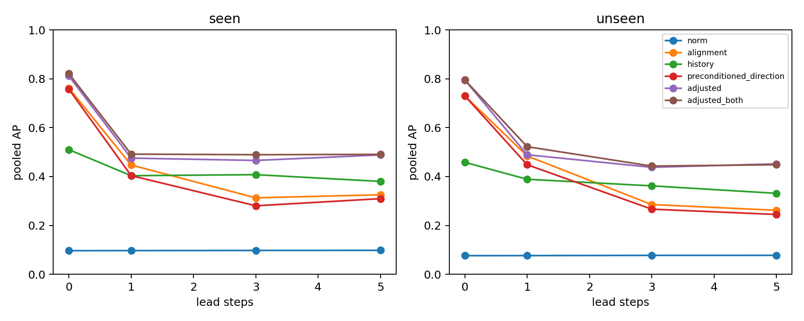
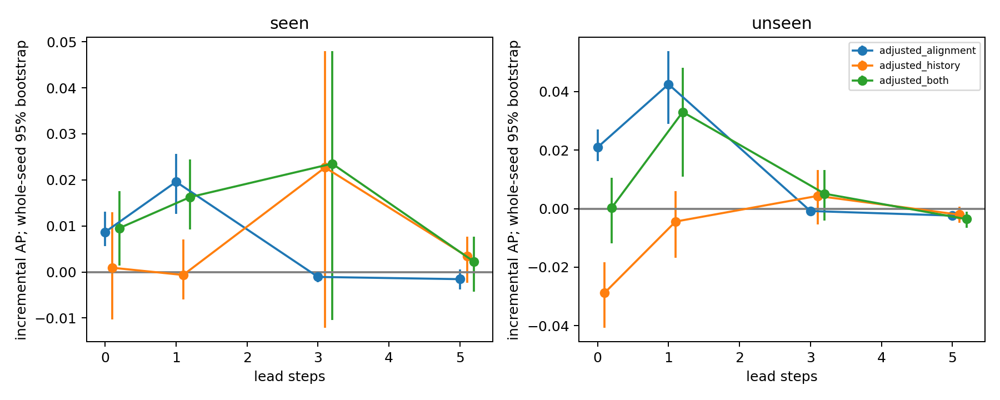

# Sprint 2 reliability analysis

**Finding:** alignment/history rank harmful updates much better than gradient norm
in pooled data, but this is largely familiar descent/oscillation geometry. Only
momentum alignment gives a small conditional pooled gain at leads 0 and 1, and
that gain does not transfer uniformly across regimes. History has no robust
incremental advantage. Neither currently supports a geometric-computation gate.

## Independent experiment and analysis

Thirty development runs: seeds 10,11 × five regimes × three AdamW rates
(.003,.03,.3). Evaluation: seeds 20–24 × ten configurations × the same three
rates = 150 runs, including five unseen configurations. All 180 completed 600
CPU float64 steps. Total execution for this stage: **94.74 seconds**. This is
a stress/diagnostic sweep, not just the best-rate optimizer trajectories: .3 is
deliberately aggressive. Development transitions occur at step 300; unseen ones
at step 200. Held-out conditions include condition 300/3000, changed anisotropic
noise scales/covariances, isotropic condition 3, and a translated optimum .5.

See [protocol](sprint2_protocol.md), [configuration](../configs/synthetic/sprint2.yaml),
[raw campaign](../results/sprint2/campaign-20261012/raw),
[complete analysis JSON](../results/sprint2/campaign-20261012/processed/reliability_analysis.json),
[metric CSV](../results/sprint2/campaign-20261012/processed/reliability_metrics.csv),
and [per-step predictions](../results/sprint2/campaign-20261012/processed/reliability_predictions.csv.gz).
The source snapshot for this stage is `source_snapshot_reliability.zip`; every raw
metadata file points to its hash. Model coefficients, development scaling,
thresholds, run IDs and bootstrap settings are saved, not reconstructed from prose.

At lead h, predict whether the actual step at t+h increases its own current
objective, using only information available at t before the optimizer update.
Drop run tails and forecasts crossing a known objective/noise transition. Leads
0,1,3,5 are evaluated separately. Forecasting an abrupt unseen event from its
future schedule is not credited as prediction.

The causal observer predicts AdamW's bias-corrected preconditioned displacement,
including epsilon, per-group LR and weight decay. It does not mutate state or use
the realized displacement. Maximum held-out prediction error was **3.33e-16**.
Tests also cover AMSGrad, maximization, multiple groups and no state mutation.

## Controls and uncertainty

The first-order logistic model includes log gradient norm, log proposed step norm,
observed-gradient alignment with that proposed descent direction, log learning
rate, known simulation noise scale, normalized phase and phase squared. The
adjusted model adds exact synthetic directional curvature, distance to optimum,
and an observed-gradient quadratic-margin interaction. These extra controls are
**privileged synthetic measurements**, not a claim of cheap deployment on neural
networks. Add momentum alignment/history separately and together to the same
adjusted features. Use fixed L2 penalty .01, equal development-run fitting weights,
development-only scaling, no model or threshold tuning on evaluation data.
Thresholds are the development-negative 95th percentile; AP itself is threshold free.

Use an identical finite-feature cohort for every comparison. Undefined angles
at the first step and effectively zero directions are excluded; saved before/after
counts document this. At lead 0, evaluation retains **75,863 / 90,000** steps.
Stationary diagonal/isotropic runs lose the largest fractions after convergence;
reported prediction metrics therefore apply to this angle-defined cohort, not
every optimization step. Raw logs retain all steps. Positive-free strata have
undefined AP, not an invented score of zero.

Resample five **whole seed clusters** 1,000 times, keeping every ordered step,
rate and configuration together, and use the same draws for paired differences.
The weighted implementation is tested against explicit whole-run duplication.
Intervals condition on the frozen two-seed development fit and finite configuration
set; they omit tuning/model-selection uncertainty. Configurations are not a random
sample of tasks. Pooled AP depends on prevalence; macro-run AP and complete
per-regime, noise, phase and LR metrics are saved. No iid-step standard errors,
uncorrected significance assertions or publication claims are made.

## Results

At lead 0, seen/unseen prevalence is .1345/.1012. Pooled held-out AP:

| Lead | Unseen norm | Unseen alignment | Unseen history | Unseen preconditioned direction | Unseen adjusted model | + alignment |
| --- | ---: | ---: | ---: | ---: | ---: | ---: |
| 0 | .0760 | .7304 | .4581 | .7301 | .7950 | .8160 |
| 1 | .0763 | .4841 | .3889 | .4483 | .4891 | .5316 |
| 3 | .0772 | .2853 | .3618 | .2663 | .4377 | .4369 |
| 5 | .0774 | .2617 | .3312 | .2447 | .4519 | .4495 |

Seen lead-0 AP: norm .0963, alignment .7620, history .5100, preconditioned
direction .7573, adjusted .8116, adjusted+alignment .8203. These figures cannot
be compared directly with pilot AP values: prevalence, rates, horizon and cohort
differ. The advantage over norm reproduces; it is not a novelty result.

Paired incremental AP relative to the adjusted model, with whole-seed 95% intervals:

| Added signal / lead | Seen configurations | Unseen configurations |
| --- | --- | --- |
| Alignment / 0 | +.0087 [.0056,.0131] | +.0209 [.0162,.0270] |
| Alignment / 1 | +.0196 [.0127,.0257] | +.0425 [.0290,.0538] |
| Alignment / 3 | -.0011 [-.0022,.0001] | -.0008 [-.0018,.0002] |
| Alignment / 5 | -.0016 [-.0038,.0006] | -.0024 [-.0036,-.0011] |
| History / 0 | +.0009 [-.0104,.0129] | -.0288 [-.0408,-.0183] |
| Both / 0 | +.0095 [.0014,.0176] | +.0003 [-.0118,.0106] |

Unseen Brier-score improvements for adding alignment are +.00217
[.00170,.00277] at lead 0 and +.00254 [.00181,.00334] at lead 1; they disappear
or become negative at longer leads. Adding history degrades unseen lead-0 AP.
These limited conditional findings concern a frozen regularized predictor, not
proof that an additional signal contains information outside all possible
first-order/geometry models.

The apparent pooled alignment gain is **not regime-uniform**. At lead 0,
adjusted+alignment minus adjusted AP by unseen regime is changing -.0008,
diagonal +.0042, isotropic -.0208, noisy +.0050, rotated -.0159. Seen noisy gain
is only +.0010. At lead 1 the unseen rotated gain remains negative (-.0154).
At LR=.003 there are **zero harmful labels** in both held-out subsets, so AP is
undefined there. Small conditional pooled gains coexist with task/rate variation
and do not establish a robust general gate. Evaluating only aggressive rates
would overstate the practical importance of the diagnostic.

## Geometry versus additional predictive information

For quadratic f and a proposed displacement s, the exact change is

`Δf = ∇f(x)ᵀs + 0.5 sᵀHs`.

This is a before-update **oracle** check, using true synthetic gradient/Hessian.
Its lead-0 AP is 1.000 on seen and unseen cohorts. It matches logged actual loss
changes in tests; it is never used by a correction or as a learned future label.
Thus same-step harmful-update prediction is completely determined by known
descent geometry on these toys. Negative momentum alignment/history can proxy
overshoot, momentum lag and oscillation; gradient norm alone omits direction.
The actual preconditioned-direction score is as strong as unpreconditioned
momentum alignment at lead 0 (unseen AP difference -.0003 [-.0156,.0112]).

With gradient noise, observed directional descent does not imply true descent,
and excessive magnitude can outweigh a downhill linear term. In development,
only 31.1% of harmful updates point uphill against the observed gradient. Clipping
and rate control address magnitude; momentum reset addresses that uphill subset.
The oracle's future AP falls substantially because the current quadratic change
is not a forecast of later noise/optimizer dynamics. Alignment's small lead-1
gain is compatible with known momentum dynamics; no geometric novelty follows.

**Decision from Task B:** alignment is worth retaining as a cheap descriptive
control and a restart trigger for an exploratory remedy test. History does not
pass unseen incremental validation. A causal trigger for expensive geometry is
not established. Stronger first-order predictor families, more development
seeds and genuinely new task families are needed before revisiting that gate.
